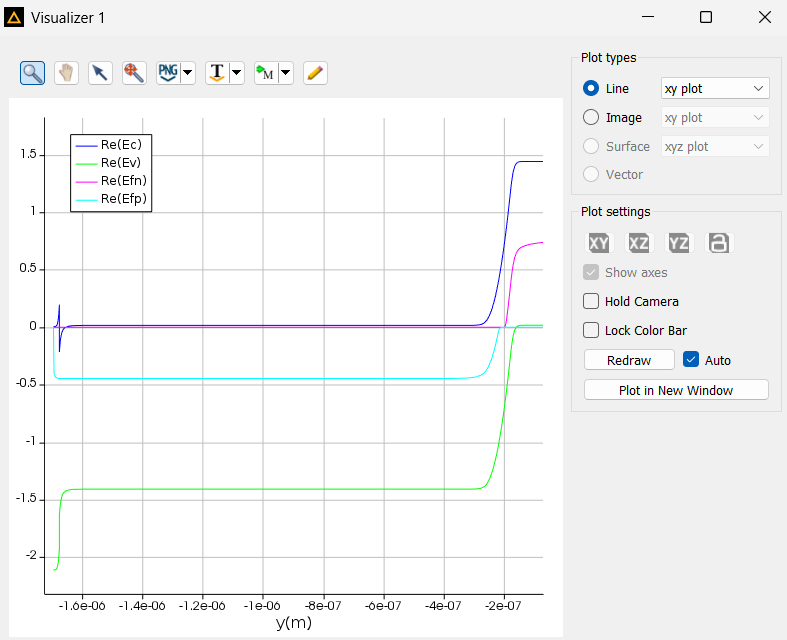
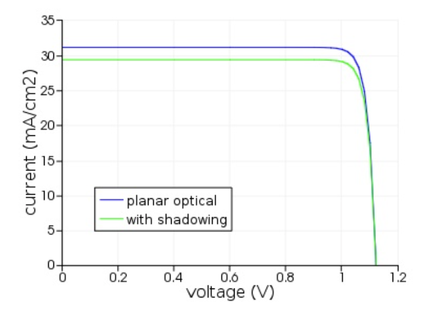

# GaAs Solar Cell Efficiency vs. the Shockley–Queisser Limit

Simulation study of a thin-film **GaAs/AlGaAs heterojunction solar cell** in **Ansys Lumerical CHARGE** (with FDTD optics), analyzing how close a single-junction GaAs cell can get to the **Shockley–Queisser (SQ) limit**. The project rebuilds a device model step by step, from an ideal cell to a realistic one, and then runs parametric sweeps of Al mole fraction, layer thickness and doping.

Developed for *TE2049 – Fundamentals of Solid-State Physics and Optoelectronics* at Tecnológico de Monterrey (June 2025).

> 📄 **Full report (Spanish):** [`docs/Reporte_Celda_Solar_GaAs.pdf`](docs/Reporte_Celda_Solar_GaAs.pdf)
> ☀️ **Lumerical device model:** [download from the latest release](../../releases/latest)

---

## Background

The SQ limit is the maximum efficiency of a single-junction cell under AM1.5G illumination: about **33.7 %** at the optimal 1.34 eV bandgap, and **32.8 %** for GaAs (Eg ≈ 1.43 eV). Real cells fall short because of optical losses (reflection, incomplete absorption, contact shadowing) and electrical losses (non-radiative recombination, finite mobility, series resistance). GaAs is a natural test case because its bandgap is close to optimal and its high internal luminescence efficiency enables **photon recycling**.

The device is a GaAs p-n junction clad by AlGaAs layers, which act as minority-carrier blocking layers at the top and bottom heterointerfaces.

<p align="center">
  
</p>

---

## Part 1 — From ideal to realistic cell (Lumerical CHARGE)

Built on Ansys's *Thin-film GaAs solar cell* example, loss mechanisms were added one at a time to see how much each one costs:

| Model | Losses included | Jsc (mA/cm²) | Voc (V) | Efficiency |
|---|---|---|---|---|
| Ideal | Perfect absorption, infinite mobility, radiative recombination only | 32.6 | 1.12 | **32.4 %** |
| + Realistic optics | Reflection, incomplete absorption, contact shadowing | 28.6 | — | 28.2 % |
| + Electrical losses | Finite mobility, SRH/Auger recombination, series resistance | — | — | 26.2 % |
| + Photon recycling | Asbeck coefficient Φ = 4.6 | — | — | **27.5 %** |

The final 27.5 % lands close to the **28.3 %** experimental record for the reference design [Wang et al., 2013].

<p align="center">
  
</p>

**What it shows:** optical losses mainly cut **Jsc**, non-radiative recombination mainly cuts **Voc**, and photon recycling recovers part of the voltage loss. Series resistance has a smaller but visible effect.

---

## Part 2 — Parametric sweeps

Three design questions from the reference paper were explored. Each was first attempted as a CHARGE sweep (raw results in the report's appendix). Because of difficulties setting up those sweeps, the main trend analysis was done in **MATLAB** with a **simplified analytical diode model**: Jsc and Voc are expressed as empirical functions of each parameter, and efficiency is taken from the maximum-power point of the resulting J–V curve. These are trend studies, not full device solves.

| Sweep | Range | Best case | Efficiency |
|---|---|---|---|
| Al mole fraction (x in AlₓGa₁₋ₓAs) | 0.1 – 0.9 | x = 0.10 | 31.65 % |
| GaAs / AlGaAs thickness | 1.0–2.5 µm / 0.01–0.1 µm | 2.5 µm / 0.1 µm | 30.93 % |
| p / n doping and doped-region height | 10¹⁷–10¹⁹ / 10¹⁶–10¹⁸ cm⁻³, 0.1–0.5 µm | p = 6×10¹⁸, n = 1×10¹⁸ cm⁻³, 0.1 µm | 29.87 % |

**Trends:** lower Al content and a thicker GaAs absorber (more absorption, from ~23 % to ~31 % efficiency) raise efficiency, while AlGaAs thickness has a smaller effect. In practice, thicker layers trade off against cost, recombination and series resistance.

---

## Repository Contents

```
lumerical/
  solar_gaas.fsp                       FDTD optical model (generation rate)
  solar_gaas.lsf                       Main analysis script
  solar_gaas_ideal_1d_absoprtion.lsf   Ideal-absorption case
  solar_gaas_shadow.lsf                Contact-shadowing case
  solar_gaas_recomb.lsf                Recombination analysis
matlab/
  sweep_al_fraction.m                  Al mole-fraction sweep
  sweep_thickness.m                    Layer-thickness sweep
  sweep_doping.m                       Doping-level and doped-height sweep
docs/
  Reporte_Celda_Solar_GaAs.pdf         Full report (Spanish)
images/                                Figures used in this README
```

The CHARGE device model (`solar_gaas.ldev`, ~54 MB) is too large for the repo and is attached to the [**latest release**](../../releases/latest).

### Running

- **Lumerical:** download `solar_gaas.ldev` from the [latest release](../../releases/latest) and place it in `lumerical/` next to the `.fsp` and scripts. Open it in Ansys Lumerical CHARGE and run the scripts from the script editor. The `.fsp` provides the optical generation profile.
- **MATLAB:** run any script in `matlab/`. They are standalone and need no toolboxes.

---

## References

- X. Wang *et al.*, "Design of GaAs Solar Cells Operating Close to the Shockley–Queisser Limit," *IEEE J. Photovoltaics*, 3, 737 (2013).
- Ansys Optics, [Thin-film GaAs solar cell](https://optics.ansys.com/hc/en-us/articles/360042160334-Thin-film-GaAs-solar-cell) application example.
- W. Shockley and H. J. Queisser, "Detailed Balance Limit of Efficiency of p-n Junction Solar Cells," *J. Appl. Phys.*, 32, 510 (1961).

---

**Author:** Armando Gordillo Ramírez — Advisor: Dr. José Isabel Gómez Quiñones, Tecnológico de Monterrey.
